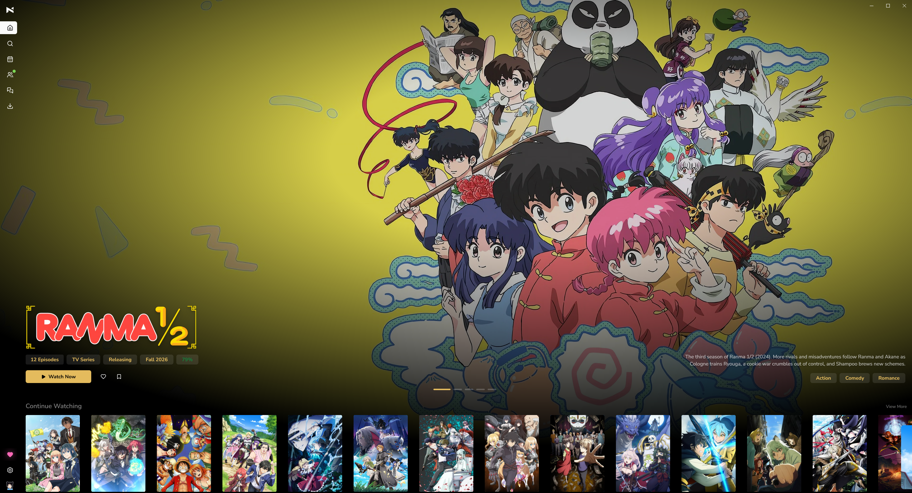
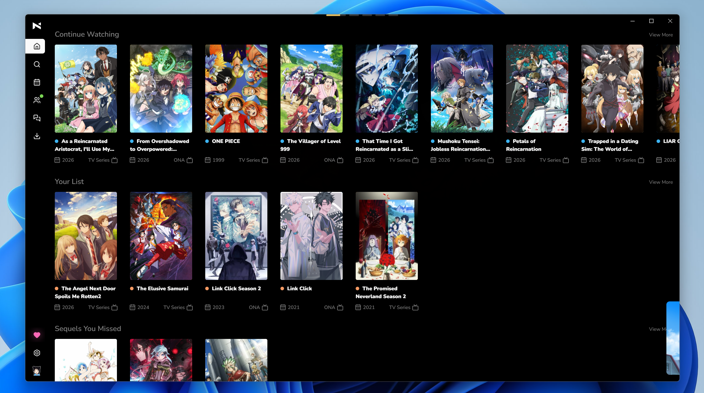
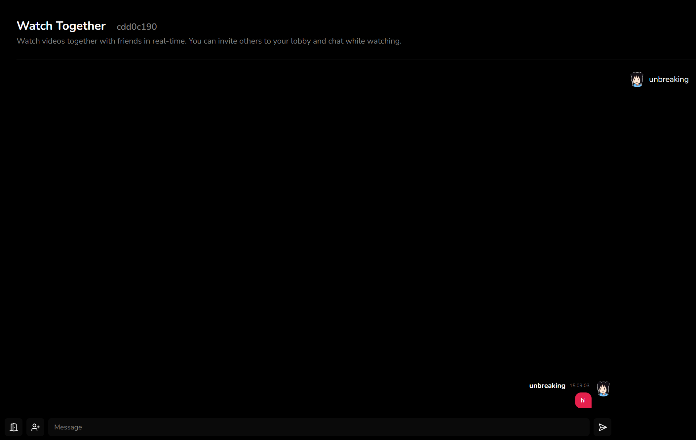
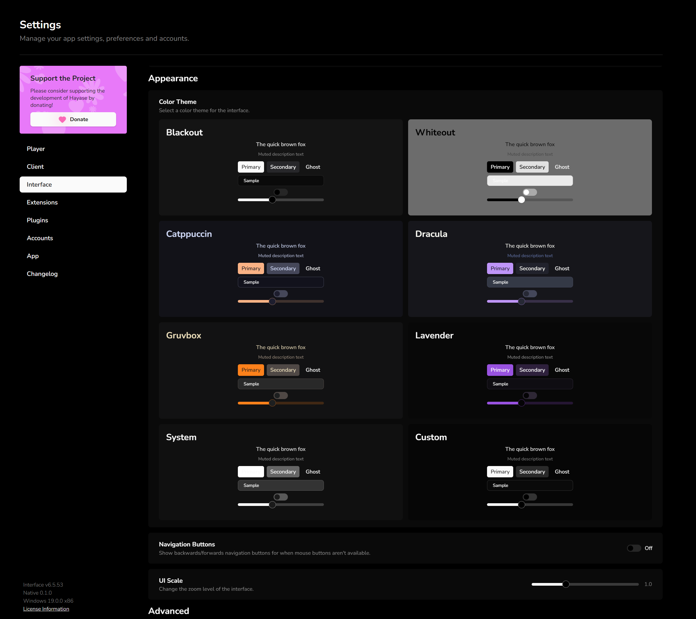

# Anesa (أنيسا)

[](LICENSE)

Anesa هو عميل سطح مكتب لوسائط الأنمي مبني على **Tauri 2 + Rust** (الخلفية) وواجهة **SvelteKit** (الأمامية). إنها نسخة من تطبيق Hayase إلى غلاف سطح مكتب أصلي: بث التورنت، تتبع AniList/Kitsu/MyAnimeList/SIMKL، استخراج الترجمات المضمنة، المشاهدة معاً (W2G)، ودردشة IRC.

- **لغات أخرى**: [English](README.md) · [日本語](README.ja.md)
- **التوثيق الكامل**: [`documentation/`](documentation/)

---

## جدول المحتويات

1. [الميزات](#الميزات)
2. [لقطات الشاشة](#لقطات-الشاشة)
3. [البدء السريع](#البدء-السريع)
4. [الهيكل](#الهيكل)
5. [فهرس التوثيق](#فهرس-التوثيق)
6. [المساهمة](#المساهمة)
7. [الرخصة](#الرخصة)

---

## الميزات

- **تتبع الأنمي**: AniList، Kitsu، MyAnimeList، SIMKL. بحث، قوائم، جدول موسمي، علاقات، مواضيع.
- **عميل تورنت**: إضافة مغناطيس/تورنت، قائمة ملفات، بث HTTP Range، إحصاءات peers/trackers، حفظ المكتبة، حدود السرعة، إدارة مجلد التنزيل.
- **مشغل الوسائط**: HTML5 أصلي + MediaBunny، عرض ترجمات ASS/SSA عبر JASSUB، خطوط، فصول، PiP، لقطات.
- **الترجمات المضمنة**: استخراج EBML مباشر من تدفق التورنت (tracks، zlib، TimestampScale). يعمل أثناء التنزيل.
- **المشاهدة معاً (W2G)**: لوبي P2P عبر WebRTC، مزامنة التشغيل، دردشة مشتركة، روابط دعوة.
- **دردشة عامة**: IRC (`#hayase-4e63ad915` على hybridirc.com)، صور رمزية مرتبطة بـ AniList.
- **الإضافات والملحقات**: إضافات قابلة للتثبيت، نظام plugins.
- **الإعدادات**: المظهر، المشغل، العميل، الحسابات، plugins، سجل التغييرات.

## لقطات الشاشة

> ضع لقطات الشاشة في `documentation/screenshots/`. الروابط أدناه عناصر نائبة — استبدل أسماء الملفات بملفاتك الفعلية.

- الرئيسية: 
- المشغل: 
- نظرة عامة على العميل: 
- المشاهدة معاً: 
- الإعدادات: 
- الدردشة: 

## البدء السريع

### المتطلبات

- **Rust** (stable) + `cargo`
- **Node.js** ≥ 18 + **pnpm**
- متطلبات نظام **Tauri 2** (راجع [متطلبات Tauri](https://tauri.app/start/prerequisites/))

### التثبيت والتشغيل (تطوير)

```bash
cd interface && pnpm install && cd ..
cd src-tauri && cargo tauri dev
```

### البناء

```bash
cd src-tauri && cargo tauri build
```

### الاختبارات

```bash
cd src-tauri && cargo test
cd interface && pnpm check
```

## الهيكل

```
anesa/
├── src-tauri/          # خلفية Rust (Tauri 2)
├── interface/          # أمامية SvelteKit
├── bridge/             # shim native-bridge
├── src/                # أصول أمامية (جذر)
└── documentation/      # هذا المجلد
```

## فهرس التوثيق

| الملف | الوصف |
|-------|-------|
| [`documentation/ARCHITECTURE.md`](documentation/ARCHITECTURE.md) | هندسة النظام، تدفق البيانات، خريطة الوحدات |
| [`documentation/FILES.md`](documentation/FILES.md) | فهرس كامل للملفات مع الغرض من كل ملف |
| [`documentation/DEV_GUIDE.md`](documentation/DEV_GUIDE.md) | إرشاد المطورين الجدد + مرجع للمطورين الكبار |

## المساهمة

راجع [`interface/CONTRIBUTING.md`](interface/CONTRIBUTING.md).

## الرخصة

BUSL-1.1 (راجع `LICENSE` / `interface/LICENSE`).
