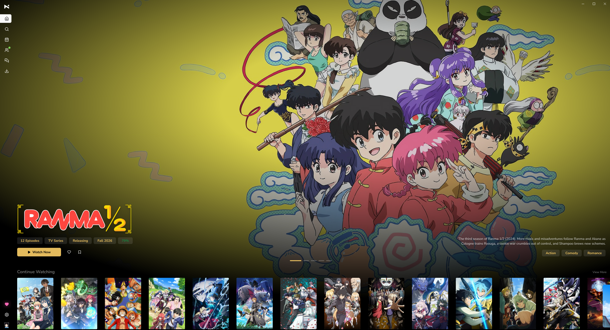
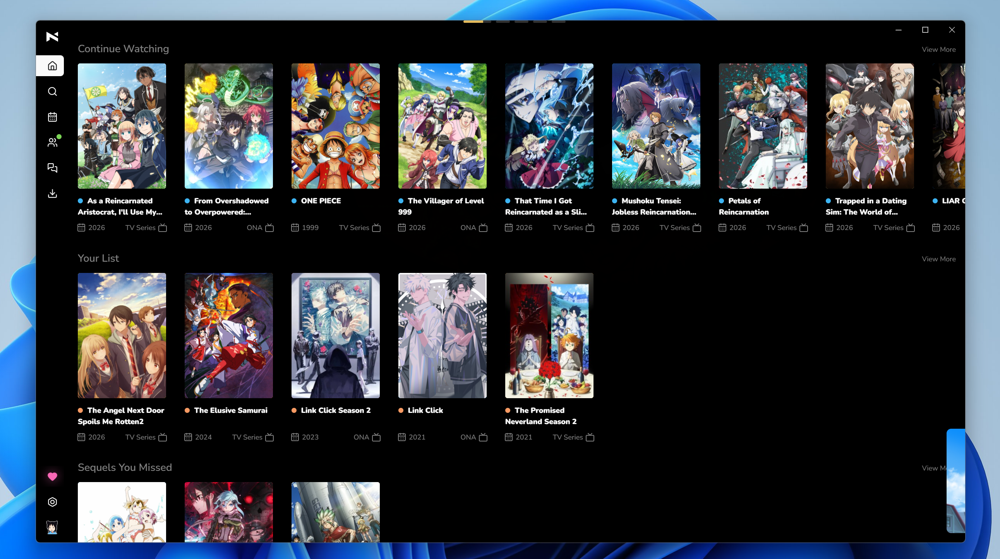
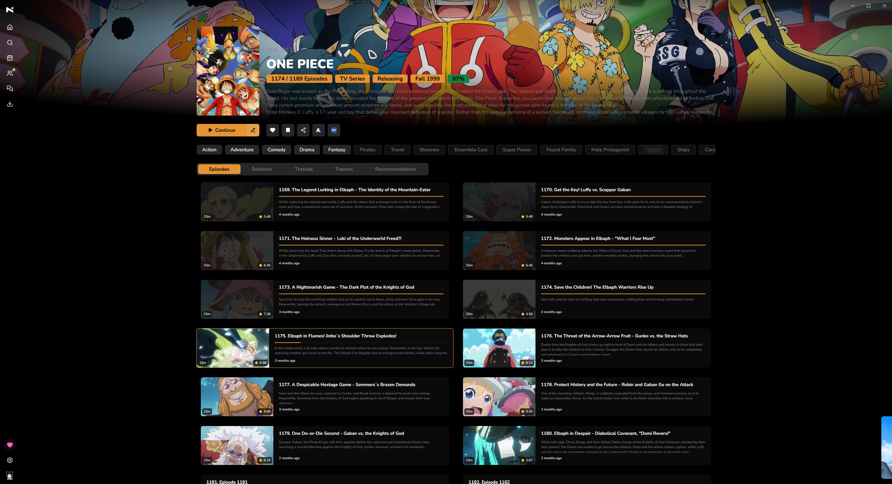
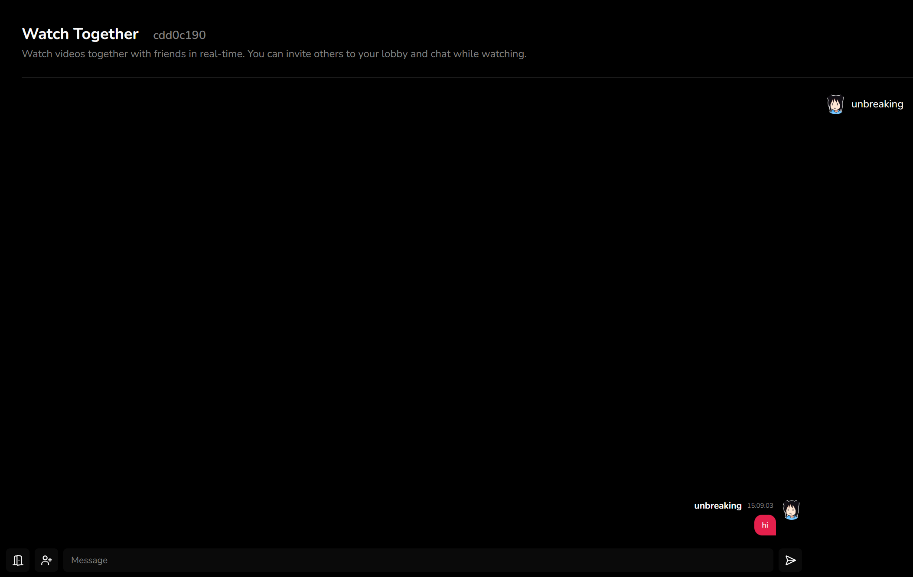
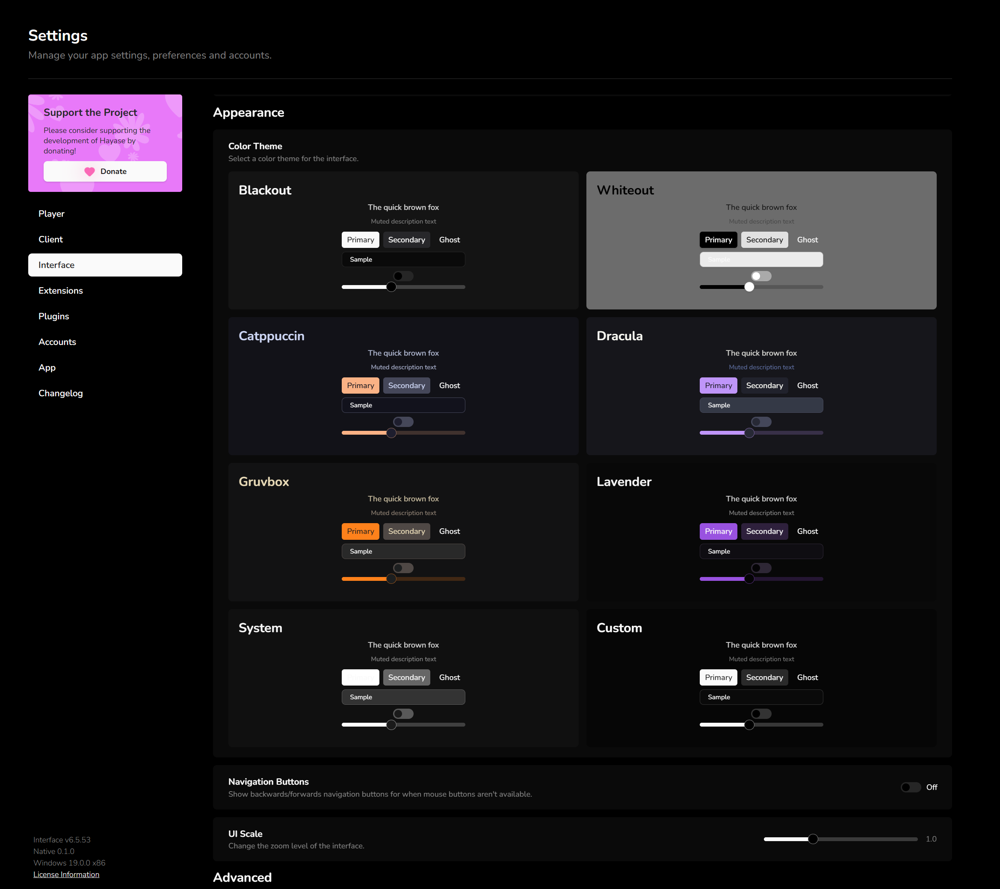

# Anesa (アネサ)

[](LICENSE)

Anesa は **Tauri 2 + Rust** (バックエンド) と **SvelteKit** (フロントエンド) で構築されたデスクトップ向けアニメメディアクライアントです。Hayase アプリをネイティブデスクトップシェルに移植したもので、トレントストリーミング、AniList/Kitsu/MyAnimeList/SIMKL 連携、埋め込み字幕抽出、Watch Together、IRC チャットを備えます。

- **他言語**: [English](README.md) · [العربية (Arabic)](README.ar.md)
- **完全なドキュメント**: [`documentation/`](documentation/)

---

## 目次

1. [機能](#機能)
2. [スクリーンショット](#スクリーンショット)
3. [クイックスタート](#クイックスタート)
4. [アーキテクチャ](#アーキテクチャ)
5. [ドキュメント索引](#ドキュメント索引)
6. [コントリビュート](#コントリビュート)
7. [ライセンス](#ライセンス)

---

## 機能

- **アニメ追跡**: AniList、Kitsu、MyAnimeList、SIMKL。検索、リスト、季節スケジュール、関連作品、スレッド。
- **トレントクライアント**: マグネット/トレント追加、ファイル一覧、HTTP Range ストリーミング、ピア/トラッカー統計、ライブラリ永続化、速度制限、ダウンロードディレクトリ管理。
- **メディアプレーヤー**: ネイティブ HTML5 + MediaBunny フォールバック、JASSUB による ASS/SSA 字幕描画、フォント、チャプター、PiP、スクリーンショット。
- **埋め込み字幕**: トレントストリームからのライブ EBML 抽出 (tracks、zlib 圧縮、TimestampScale 正規化)。ダウンロード中でも動作。
- **Watch Together (W2G)**: WebRTC P2P ロビー、再生同期、共有チャット、招待リンク。
- **グローバルチャット**: IRC (`hybridirc.com` の `#hayase-4e63ad915`)、AniList 連動アバター。
- **拡張・プラグイン**: ユーザーインストール可能な拡張、プラグインシステム。
- **設定**: 外観、プレーヤー、クライアント、アカウント、プラグイン、変更履歴。

## スクリーンショット

>プレーヤー: 
>ホーム: 
>クライアント概要: 
> 
>一緒に視聴:  
>設定: 

## クイックスタート

### 前提条件

- **Rust** (stable) + `cargo`
- **Node.js** ≥ 18 + **pnpm**
- **Tauri 2** のシステム依存 ( [Tauri 前提条件](https://tauri.app/start/prerequisites/) )

### インストールと実行 (開発)

```bash
cd interface && pnpm install && cd ..
cd src-tauri && cargo tauri dev
```

### ビルド

```bash
cd src-tauri && cargo tauri build
```

### テスト

```bash
cd src-tauri && cargo test
cd interface && pnpm check
```

## アーキテクチャ

```
anesa/
├── src-tauri/          # Rust バックエンド (Tauri 2)
├── interface/          # SvelteKit フロントエンド
├── bridge/             # native-bridge shim
├── src/                # ルートフロントエンド資産
└── documentation/      # このフォルダ
```

## ドキュメント索引

| ファイル | 説明 |
|---------|------|
| [`documentation/ARCHITECTURE.md`](documentation/ARCHITECTURE.md) | システムアーキテクチャ、データフロー、モジュールマップ |
| [`documentation/FILES.md`](documentation/FILES.md) | 全ファイル索引と各ファイルの目的 |
| [`documentation/DEV_GUIDE.md`](documentation/DEV_GUIDE.md) | 新規開発者ガイド + シニア開発者リファレンス |

## コントリビュート

[`interface/CONTRIBUTING.md`](interface/CONTRIBUTING.md) を参照。

## ライセンス

BUSL-1.1 (`LICENSE` / `interface/LICENSE` を参照)。
