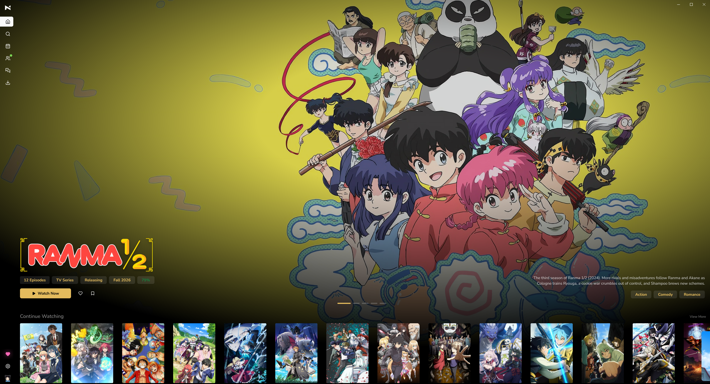
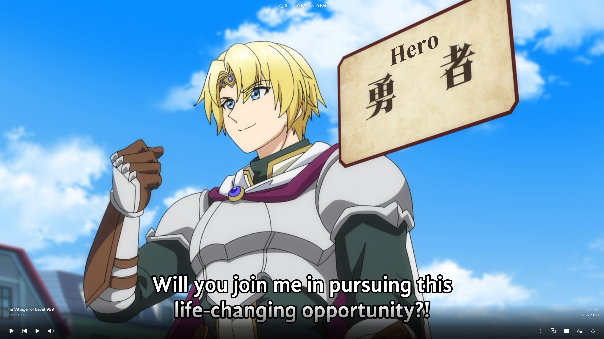
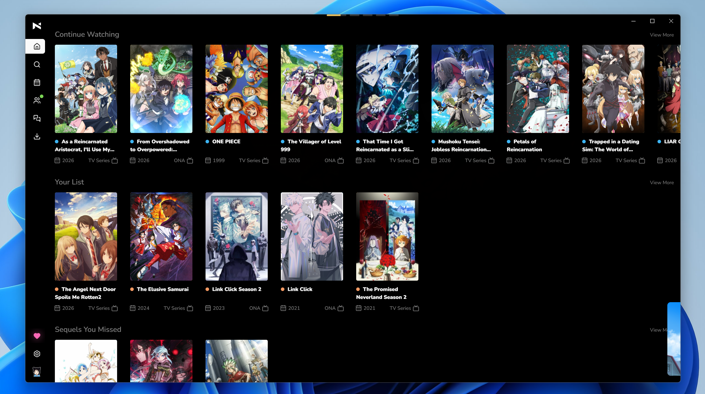
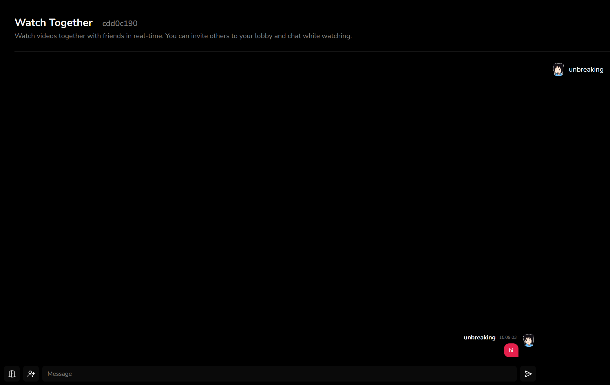
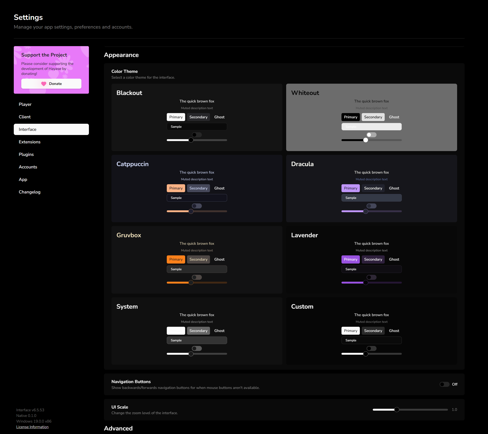

# Anesa

[](LICENSE)

Anesa is a desktop anime media client built on **Tauri 2 + Rust** (backend) and a **SvelteKit** frontend. It is a port of the Hayase application to a native desktop shell: torrent streaming, AniList/Kitsu/MyAnimeList/SIMKL tracking, embedded subtitle extraction, Watch Together, and an IRC chat.

- **Other languages**: [العربية (Arabic)](README.ar.md) · [日本語 (Japanese)](README.ja.md)
- **Full docs**: [`documentation/`](documentation/)

---

## Table of contents

1. [Features](#features)
2. [Screenshots](#screenshots)
3. [Quick start](#quick-start)
4. [Architecture](#architecture)
5. [Documentation index](#documentation-index)
6. [Contributing](#contributing)
7. [License](#license)

---

## Features

- **Anime tracking**: AniList, Kitsu, MyAnimeList, SIMKL. Search, lists, seasonal schedule, relations, threads.
- **Torrent client**: add magnets/torrents, file listing, HTTP Range streaming, peer/tracker stats, library persistence, speed limits, download directory management.
- **Media player**: native HTML5 + MediaBunny fallback, ASS/SSA subtitle rendering via JASSUB, fonts, chapters, PiP, screenshots.
- **Embedded subtitles**: live EBML extraction from the torrent stream (tracks, zlib-compressed, TimestampScale-correct). Works while downloading.
- **Watch Together (W2G)**: P2P lobby over WebRTC, playback sync, shared chat, invite links.
- **Global chat**: IRC (`#hayase-4e63ad915` on hybridirc.com), AniList-linked avatars.
- **Extensions & plugins**: user-installable extensions, plugin system.
- **Settings**: appearance, player, client, accounts, plugins, changelog.

## Screenshots

> Place screenshots in `documentation/screenshots/`. The links below are placeholders — replace the filenames with your actual files.

- Home: 
- Player: 
- Client overview: 
- Watch Together: 
- Settings: 
- Chat: 

## Quick start

### Prerequisites

- **Rust** (stable) + `cargo`
- **Node.js** ≥ 18 + **pnpm**
- **Tauri 2** system dependencies (see [Tauri prerequisites](https://tauri.app/start/prerequisites/))

### Install & run (dev)

```bash
# frontend deps
cd interface && pnpm install && cd ..

# run tauri dev
cd src-tauri && cargo tauri dev
```

### Build

```bash
cd src-tauri && cargo tauri build
```

### Tests

```bash
cd src-tauri && cargo test
cd interface && pnpm check
```

## Architecture

```
anesa/
├── src-tauri/          # Rust backend (Tauri 2)
│   └── src/
│       ├── commands.rs # Tauri command surface
│       ├── torrent/    # librqbit engine, streaming, EBML subtitles
│       ├── player/     # player state
│       ├── events.rs   # event names
│       └── ...
├── interface/          # SvelteKit frontend
│   └── src/
│       ├── routes/     # pages (app/*, setup/*, ...)
│       └── lib/        # components, modules, utils
├── bridge/             # native-bridge shim
├── src/                # (root frontend assets)
└── documentation/      # this folder
```

High-level data flow:

```
Frontend (SvelteKit)  <--Tauri IPC/events-->  Rust backend (librqbit)
       │                                              │
       │  native.tracks / native.subtitles / ...      │
       └── HTTP Range stream (127.0.0.1) ────────────┘
```

- The frontend calls `native.*` (bridged to `invoke('torrent_*')`).
- The backend exposes a loopback HTTP server for media streaming with Range support.
- Embedded subtitles are extracted by tapping the player's read stream + a sequential full-file pass.

## Documentation index

| File | Description |
|------|-------------|
| [`documentation/ARCHITECTURE.md`](documentation/ARCHITECTURE.md) | System architecture, data flow, module map |
| [`documentation/FILES.md`](documentation/FILES.md) | Complete file index with per-file purpose |
| [`documentation/DEV_GUIDE.md`](documentation/DEV_GUIDE.md) | New-developer onboarding + senior-dev reference |

## Contributing

See [`interface/CONTRIBUTING.md`](interface/CONTRIBUTING.md). General flow:

1. Fork & clone.
2. Create a feature branch.
3. Run `cargo test` and `pnpm check` before opening a PR.
4. Use `[skip ci]` in commit messages for doc-only changes.

## License

BUSL-1.1 (see `LICENSE` / `interface/LICENSE`).
